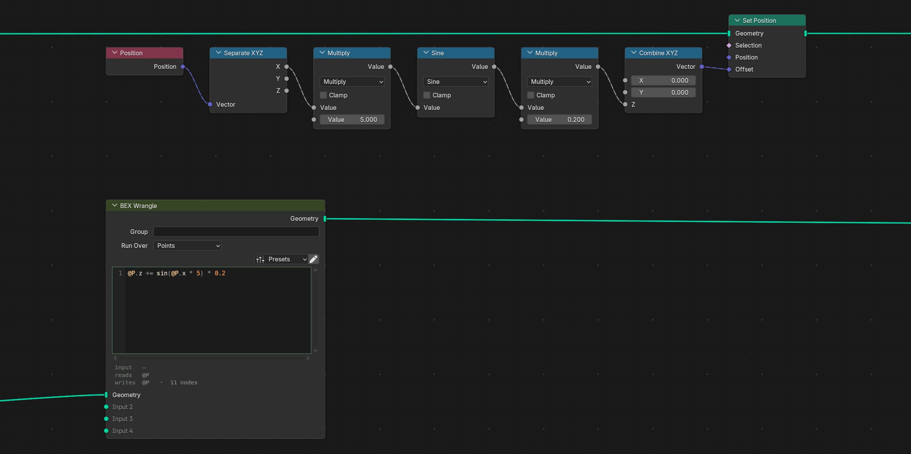
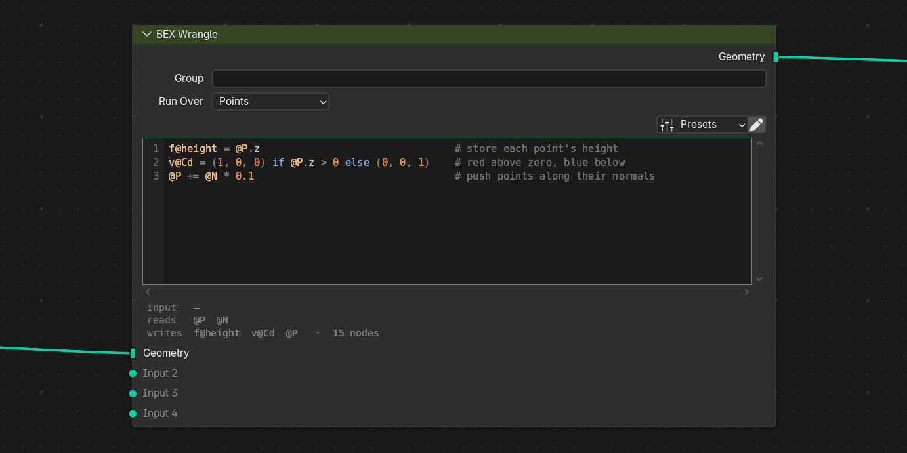
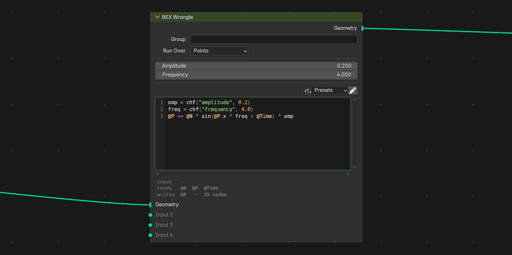
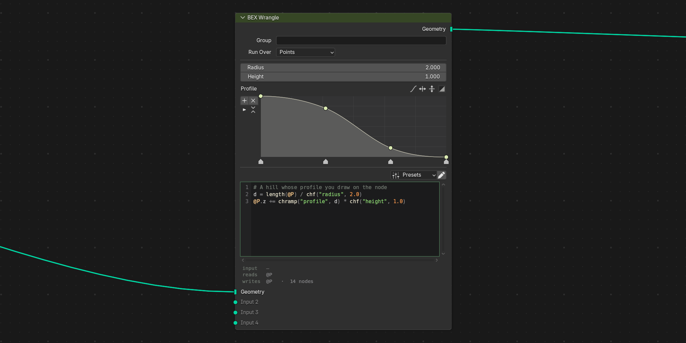
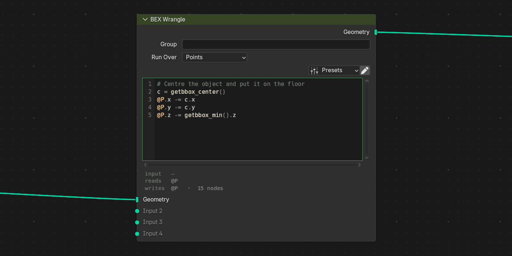
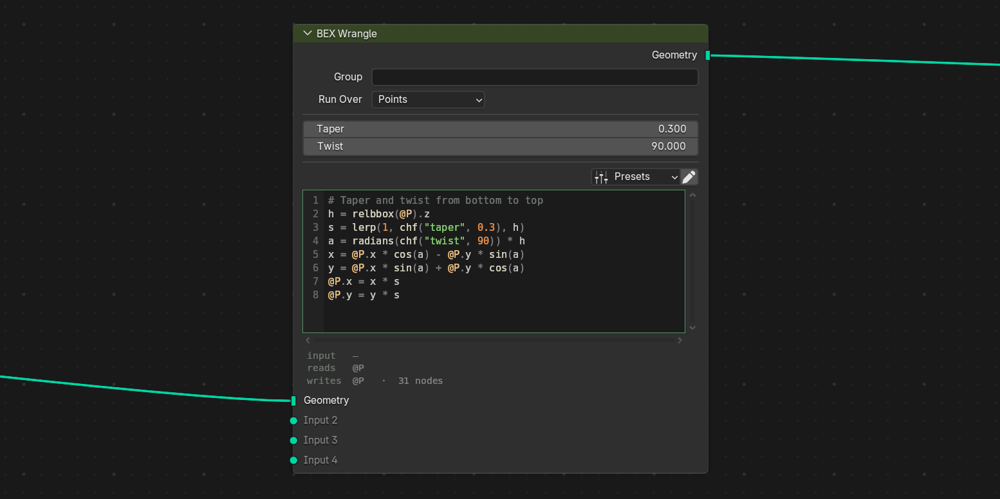
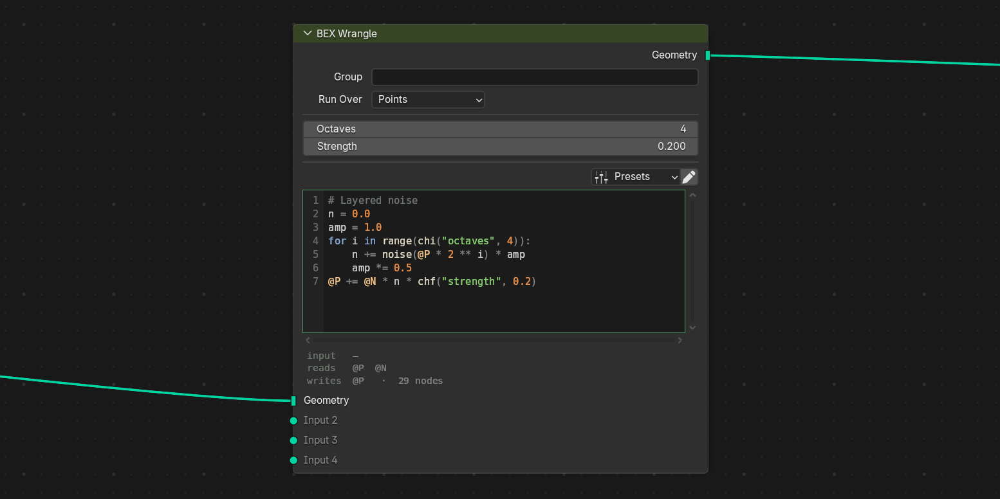
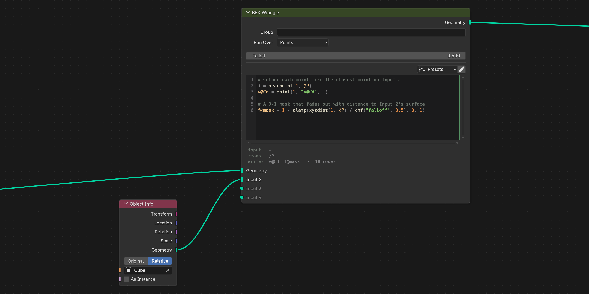

<h1 align="center">BEX</h1>

<p align="center">
  <b>BEX is a scripting language that allows you to manipulate geometry nodes.</b>
</p>

<p align="center">
  
  
  
</p>

<p align="center">
  <a href="#attributes">Attributes</a> ·
  <a href="#properties-on-the-node">Properties</a> ·
  <a href="#ramps">Ramps</a> ·
  <a href="#helper-functions">Helpers</a> ·
  <a href="#its-just-python">Python</a> ·
  <a href="#other-inputs">Inputs</a> ·
  <a href="#functions">Functions</a> ·
  <a href="#install">Install</a>
</p>

---

Doing simple operations is now simple. This is one line of BEX:

```python
@P.z += sin(@P.x * 5) * 0.2
```

And this is what it would take to write it as nodes:

<p align="center"></p>

BEX adds one node, the **BEX Wrangle**. You type a script on the node, and BEX turns it
into ordinary geometry nodes inside it.

<!-- TODO: GIF of typing a script on the node and the viewport updating -->

## Attributes

You can access attributes by using the `@` symbol and the name, and assign them like this as well:

<p align="center"></p>

```python
f@height = @P.z                                    # store each point's height
v@Cd = (1, 0, 0) if @P.z > 0 else (0, 0, 1)        # red above zero, blue below
@P += @N * 0.1                                     # push points along their normals
```

The letter before `@` sets the type: `f@` float, `i@` integer, `v@` vector, `b@` true/false.
Without it, an attribute is a float, except the well-known names below.
Writing an attribute that doesn't exist creates it.

### Built-in attributes

These are always there. They're what makes a wrangle quick: no Index node, no Position node,
no Separate XYZ.

| Attribute | What it is |
|---|---|
| `@P` | Position. `@P.x`, `@P.y`, `@P.z` for one axis (also `@P.0`, `@P[0]`) |
| `@N` | Normal |
| `@ptnum` | The point's number (on Corners: the corner's point) |
| `@primnum` | The face or curve number (on Corners: the corner's face) |
| `@vtxnum` | The corner number (Corners only) |
| `@edgenum` | The edge number (Edges only) |
| `@curvenum` | The curve number, or the curve a point belongs to |
| `@elemnum`, `@index` | The number of whatever element the script runs over |
| `@numpt`, `@numprim`, `@numvtx` | How many points, faces, corners there are |
| `@id` | A stable ID (falls back to the index when there is none) |
| `@Time`, `@Frame` | The scene time in seconds, and the frame number |
| `@curveu` | How far along its curve a point is, 0 to 1 |
| `@curvelength` | The length of the curve |
| `@tangent` | The curve's direction at the point |
| `@area` | The face's area |
| `@island` | Which connected piece of the mesh the element is on |
| `@edgeangle` | The angle between the two faces of an edge |

Built-ins are read-only, except `@P` and `@id`.
Common names that already know their type: `@Cd` `@v` `@up` are vectors, `@pscale` `@radius` are floats.

### A few examples

<table>
<tr>
<td width="50%">

```python
# Random jitter, and a random size per point
@P += vrand(@ptnum) - 0.5
f@pscale = fit01(rand(@id), 0.5, 1.5)
```

</td>
<td width="50%">

```python
# Every other point
i@even = @ptnum % 2 == 0
```

</td>
</tr>
<tr>
<td>

```python
# Flood everything below the water line
if @P.z < 0:
    @P.z = 0
    v@Cd = (0.1, 0.3, 0.8)
```

</td>
<td>

```python
# Colour by height, inside the bounding box
v@Cd = lerp((0, 0, 1), (1, 0.5, 0), relbbox(@P).z)
```

</td>
</tr>
</table>

## Properties on the node

Create properties on the node with just a simple line of code, which allows you to control values inside the script:

<p align="center"></p>

```python
amp = chf("amplitude", 0.2)
freq = chf("frequency", 4.0)
@P += @N * sin(@P.x * freq + @Time) * amp
```

`chf` makes a number, `chi` a whole number, `chv` a vector, `chb` a checkbox. The second value is the default.
They can be keyframed and driven like any property, or plugged into from outside (Ctrl+H shows the socket).
Delete the line and bring it back later: the value you set is remembered.

### Ramps

`chramp("name", position)` is an easy to use ramp to adjust your data. It reads the ramp at a position from 0 to 1:

<p align="center"></p>

```python
# A hill whose profile you draw on the node
d = length(@P) / chf("radius", 2.0)
@P.z += chramp("profile", d) * chf("height", 1.0)
```

<!-- TODO: GIF of dragging ramp points and the hill changing -->

Ramps work like Houdini's: Constant, Linear, Catmull-Rom, Monotone Cubic, B-Spline and Bezier,
with the same presets. Click to add a point, drag to move it, Ctrl+click to delete.

## Helper functions

Helper functions like `getbbox_min()`, `getbbox_center()` and `relbbox()` do in one word what takes
a handful of nodes.

<p align="center"></p>

```python
# Centre the object and put it on the floor
c = getbbox_center()
@P.x -= c.x
@P.y -= c.y
@P.z -= getbbox_min().z
```

`relbbox(@P)` tells you where a point sits inside the bounding box, 0 to 1 on each axis.
That's all you need for anything that goes from bottom to top:

<p align="center"></p>

```python
# Taper and twist from bottom to top
h = relbbox(@P).z
s = lerp(1, chf("taper", 0.3), h)
a = radians(chf("twist", 90)) * h
x = @P.x * cos(a) - @P.y * sin(a)
y = @P.x * sin(a) + @P.y * cos(a)
@P.x = x * s
@P.y = y * s
```

Eight lines, 31 nodes. Helpers that take several nodes are built as node groups (**BEX Bounding Box**,
**BEX Relative Bounding Box**), and you can add them to any tree from **Add → BEX**.

## It's just Python

BEX parses the Python into geometry nodes in a really smart way. `if` / `elif` / `else`,
`while` and functions with `def` all work. For loops also work, by making a Repeat Zone:

<p align="center"></p>

```python
# Layered noise
n = 0.0
amp = 1.0
for i in range(chi("octaves", 4)):
    n += noise(@P * 2 ** i) * amp
    amp *= 0.5
@P += @N * n * chf("strength", 0.2)
```

- An `if` that depends on the geometry becomes a per-element Switch, or just a Selection on the write.
- Short loops are written out, loops that only compute numbers disappear, longer ones become one
  Repeat Zone. `break`, `continue` and `while` work too, even when every point stops at a different time.
- A function used in several places is built once, as a Closure.
- Things that work out to a constant are computed while compiling: `fib(10)` is just 55.

```python
def bump(p, size=1.0):
    return max(0, 1 - length(p) / size)

@P.z += bump(@P - chv("center", (0, 0, 0)), chf("size", 1.0))
```

Press **Tab** on the node to see the nodes it built.

## Other inputs

You can connect extra geometry to the inputs. That way you can access it by using `point()` and all the
other functions below. Only the first input flows through. Inputs count from 0 in the script, so `1` means **Input 2**.

<p align="center"></p>

```python
# Colour each point like the closest point on Input 2
i = nearpoint(1, @P)
v@Cd = point(1, "v@Cd", i)

# A 0-1 mask that fades out with distance to Input 2's surface
f@mask = 1 - clamp(xyzdist(1, @P) / chf("falloff", 0.5), 0, 1)
```

`@opinput1_name` reads attribute `name` from the element with the same number on input 1.
The functions under [Reading other geometry](#reading-other-geometry) all take an input number first.

## Group and Run Over

**Run Over** picks what the script loops over: Points, Edges, Faces, Corners, Curves or Instances.

**Group** limits which elements it changes; the rest keep their values. It takes Houdini patterns
or any BEX expression. Empty means everything.

| Group | Elements |
|---|---|
| `top` (also `@top`, `@group_top`) | where the true/false attribute `top` is true |
| `3`, `2-5`, `0-10:3` | by number: one, a range, every 3rd |
| `top 0-9` | either one (space = or) |
| `!top` | everything not in `top` |
| `* ^top` | everything, minus `top` |
| `@P.y > 0 and not top` | any expression |

## Functions

A glossary of everything BEX knows, grouped by what it's for. Arguments in `[brackets]` are optional. Vectors work wherever it makes sense (per axis).

### Properties

| Function | What it does |
|---|---|
| `chf(name, [default])` | A number slider on the node |
| `chi(name, [default])` | A whole-number field on the node |
| `chv(name, [default])` | A vector field on the node |
| `chb(name, [default])` | A checkbox on the node |
| `chramp(name, position)` | A ramp on the node, read at position 0 to 1 |

### Maths

| Function | What it does |
|---|---|
| `abs(x)` | Drops the minus sign |
| `sign(x)` | -1, 0 or 1 |
| `floor(x)`, `ceil(x)` | Rounds down, rounds up |
| `round(x)`, `rint(x)` | Rounds to the nearest whole number |
| `trunc(x)` | Cuts off the decimals |
| `frac(x)` | Just the decimals: `frac(2.75)` is 0.75 |
| `min(a, b)`, `max(a, b)` | The smaller, the larger |
| `clamp(x, lo, hi)` | Keeps x between lo and hi |
| `mod(x, d)`, `fmod(x, d)` | Remainder after dividing. Never negative for a positive d |
| `wrap(x, lo, hi)` | Wraps x around to stay between lo and hi |
| `snap(x, step)` | Rounds down to a multiple of step |
| `pingpong(x, length)` | Goes from 0 to length and back, over and over |
| `sqrt(x)` | Square root |
| `pow(x, y)`, `x ** y` | x to the power of y |
| `exp(x)`, `log(x)`, `log10(x)` | e to the x, natural log, base-10 log |
| `sin cos tan (angle)` | In radians |
| `asin acos atan (x)`, `atan2(y, x)` | Back to an angle |
| `sinh cosh tanh (x)` | Hyperbolic |
| `radians(deg)`, `degrees(rad)` | Converts angles |
| `avg(a, b, ...)` | The average. Of one vector: the average of its axes |

Constants: `PI` (`pi`), `TAU` (`tau`).

### Remapping

| Function | What it does |
|---|---|
| `fit(x, old_min, old_max, new_min, new_max)` | Moves x from one range to another, clamped |
| `efit(...)` | Same, not clamped |
| `fit01(x, new_min, new_max)` | From 0–1 to the new range |
| `fit11(x, new_min, new_max)` | From -1–1 to the new range |
| `lerp(a, b, t)`, `mix(a, b, t)` | Blends from a (t = 0) to b (t = 1) |
| `invlerp(x, a, b)` | Where x sits between a (0) and b (1) |
| `smoothstep(lo, hi, x)`, `smooth` | 0 below lo, 1 above hi, a smooth curve between |
| `smootherstep(lo, hi, x)` | Same, with softer ends |

### Vectors

| Function | What it does |
|---|---|
| `(x, y, z)`, `vector(x, y, z)` | Makes a vector. `vector(1)` sets all three |
| `length(v)`, `length2(v)` | How long it is (squared: faster for comparing) |
| `distance(a, b)`, `distance2(a, b)` | Distance between two points (and squared) |
| `normalize(v)` | Same direction, length 1 |
| `dot(a, b)` | Dot product |
| `cross(a, b)` | A vector at right angles to both |
| `reflect(dir, n)` | Bounced off a surface |
| `refract(dir, n, ior)` | Bent through a surface |
| `faceforward(n, dir)` | n, flipped to face against dir |

### Colour

| Function | What it does |
|---|---|
| `hsvtorgb(hsv)`, `rgbtohsv(rgb)` | Hue/saturation/value ↔ RGB (each 0 to 1, hue wraps) |
| `hsltorgb(hsl)`, `rgbtohsl(rgb)` | Hue/saturation/lightness ↔ RGB |
| `luminance(rgb)` | How bright a colour is |
| `blackbody(kelvin, [brightness])` | The colour of something glowing at that temperature |

### Noise and random

| Function | What it does |
|---|---|
| `noise(p)` | Smooth noise, roughly 0 to 1 |
| `vnoise(p)` | Smooth noise, one value per axis |
| `rand(seed)` | A random number 0 to 1. Same seed, same number |
| `vrand(seed)` | A random vector |

### Types

| Function | What it does |
|---|---|
| `float(x)`, `int(x)`, `bool(x)` | Converts. `int` cuts off the decimals |
| `x: int = 2.7` | Converts on assignment |

### Bounding box

| Function | What it does |
|---|---|
| `getbbox_min([input])`, `getbbox_max([input])` | The lowest and highest corners |
| `getbbox_size([input])`, `getbbox_center([input])` | Size and centre |
| `relbbox([input], p)` | Where p sits in the box, 0 to 1 on each axis |

### Reading other geometry

| Function | What it does |
|---|---|
| `point(input, "name", i)` | Attribute `name` of point i. Type from the prefix: `"v@Cd"` |
| `prim(input, "name", i)` | Attribute of face i |
| `vertex(input, "name", i)` | Attribute of corner i |
| `npoints(input)`, `nprims(input)` | How many points, faces |
| `nvertices(input)`, `nedges(input)`, `ncurves(input)` | How many corners, edges, curves |
| `nearpoint(input, p)` | The number of the closest point |
| `xyzdist(input, p, [prim])` | Distance to the surface. A variable as `prim` gets the closest face |
| `minpos(input, p)` | The closest position on the surface |
| `intersect(input, origin, dir, [pos])` | The face a ray hits, or -1. The ray is as long as dir. A variable as `pos` gets the hit |

### Mesh topology

| Function | What it does |
|---|---|
| `primpoint(input, face, n)` | The point at a face's nth corner |
| `primvertexcount(input, face)` | How many corners a face has |
| `vertexpoint(input, corner)` | The point of a corner |
| `vertexprim(input, corner)` | The face of a corner |
| `vertexprimindex(input, corner)` | Which corner of its face it is: 0, 1, 2… |
| `neighbour(input, pt, n)` | The nth point connected to a point by an edge |
| `neighbourcount(input, pt)` | How many points are connected to it |

### Language

| | |
|---|---|
| Operators | `+ - * / // % **`, `== != < <= > >=` (chains like `0 < x <= 1`), `and or not`, `a if cond else b`, `+= -= *= /=` … |
| Control flow | `if` / `elif` / `else`, `for i in range(...)`, `while`, `break`, `continue`, `pass` |
| Functions | `def name(a, b=1):` … `return`. Call with keywords: `name(b=2, a=1)` |

Coming from VEX? `&&`, `!`, `? :`, `{ }` and `float x = …` give an error that tells you the Python way.

## The editor

Click the code on the node to edit it. It has syntax highlighting, autocomplete (**Tab** accepts the
grey suggestion), argument hints, undo, and the usual keys: Tab / Shift+Tab indent, Ctrl+/ comments,
double-click selects a word, Ctrl +/− resizes the text.

The script compiles when you click away (or press Esc or Ctrl+Enter). The outline shows where it stands:
blue while editing, green when compiled, red on an error, in which case the last working nodes are kept.
Under the code, BEX lists the attributes coming in and the ones the script reads and writes.

The pencil opens the script in Blender's Text Editor. A script linked to a file on disk updates
when you save it from any editor. **Presets** holds ready-made scripts, and **Save as Preset…** adds yours.

## Install

Requires **Blender 5.2** or later.

<!-- TODO: link to the release zip -->
Download the latest `bex.zip` from Releases, then in Blender: **Edit → Preferences → Get Extensions →
Install from Disk**. In the Geometry Nodes editor: **Add → BEX Wrangle**.

## Contributing

1. Open this folder in VS Code with the *Blender Development* extension (configured in `.vscode/settings.json`).
2. `Cmd+Shift+P` → **Blender: Start**. Saving a Python file reloads the add-on.

How it's built: [ARCHITECTURE.md](ARCHITECTURE.md). Tests:

```sh
python3 tests/test_lang.py
python3 tests/test_editor.py
python3 tests/test_ramp.py
"/Applications/Blender 5.2.app/Contents/MacOS/Blender" -b --factory-startup --python tests/test_blender.py
```

## License

GPL-3.0
